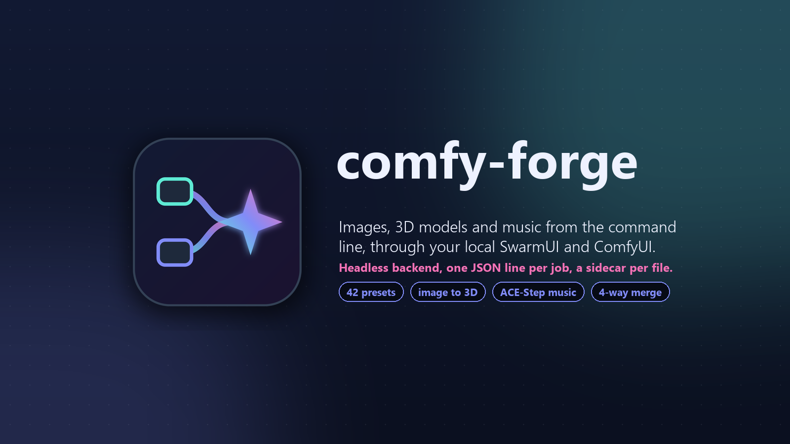
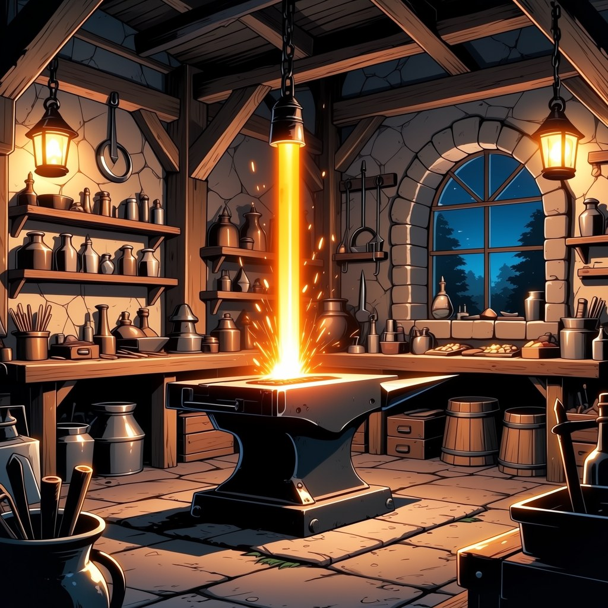
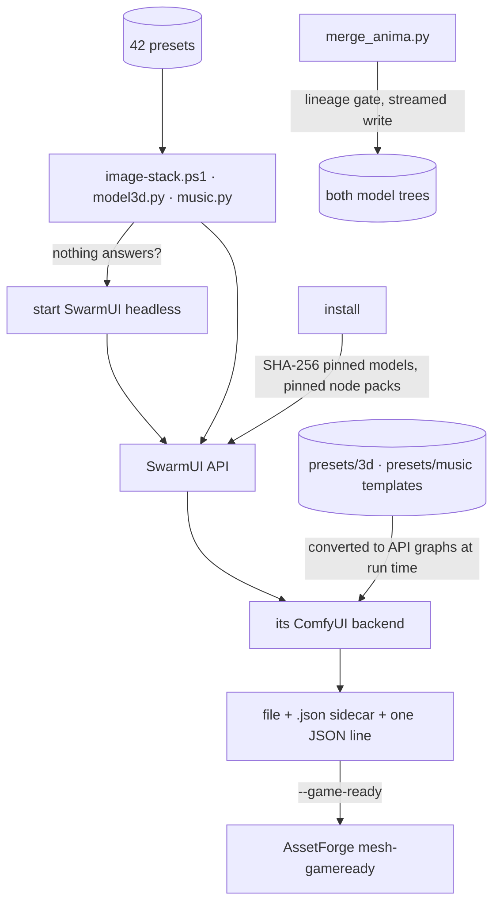

<div align="center">



[](https://github.com/SenjuWoo/comfy-forge/actions/workflows/ci.yml)
[](https://github.com/SenjuWoo/comfy-forge/releases)
[](TOOLS/image-stack.ps1)
[](https://github.com/mcmonkeyprojects/SwarmUI)
[](LICENSE)

**[Install](#install)** · **[Tour](#a-short-tour)** · **[Commands](#commands)** · **[3D](#3d-image-or-text-to-a-model)** · **[Music](#music-ace-step-15)** · **[Merging](#merging-checkpoints)** · **[How it works](#how-it-works)** · **[Changelog](CHANGELOG.md)**

</div>

comfy-forge drives a local SwarmUI (and the ComfyUI inside it) from the command line.
It installs the Anima model stack and its node packs, renders from 42 presets, turns a
picture or a sentence into a textured 3D model and then a game-ready mesh, writes songs
with ACE-Step 1.5, prepares tagged image folders for LoRA training, and merges up to four
checkpoints into one real file. It is built for people and for agents that can only write
text and code: no window has to be opened, the backend starts itself, and every job ends
with one JSON line and a sidecar beside each file.

## What you get

- **A render with no setup dance.** `generate` starts SwarmUI headless when nothing answers, picks a model that fits the preset's family, and saves each image with a `.json` sidecar holding its seed and settings, so any render can be repeated.
- **Image options in one verb.** Image to image, inpaint, LoRA, transparent background, tileable texture (UNet models), upscale, and any other SwarmUI parameter through `-Set key=value`.
- **3D from a picture or a sentence.** Shipped Pixal3D, TRELLIS.2 and Idol templates run without the node editor. `--game-ready` hands the 700,000-triangle sculpt to [AssetForge](https://github.com/SenjuWoo/AssetForge), which writes a mesh at or under 20,000 triangles.
- **Songs that can be replayed.** ACE-Step 1.5 through ComfyUI's own nodes. Every take has a sidecar, `--from` renders it again sample for sample, and a take that goes silent before the end is flagged.
- **Training data you can trust.** A folder of booru-tagged images becomes an Anima-style dataset and a verified upload archive. Existing tags are kept, duplicates and post-bookkeeping tags are dropped with a named reason, and the source folder is never written to.
- **Merges that refuse to make black images.** Task arithmetic over up to four checkpoints, with a lineage gate that catches the 40-block/28-block Anima mix-up before it wastes a render.
- **Facts for a program.** `capabilities` prints one JSON object: every lane, whether it is ready, the command that runs it and the command that fixes what is missing.


<p align="center">
  
  <br>
  <sub>The file written by the run above: preset <code>Anima - Author Daily (Euler + SGM)</code>, 28 steps, seed 1, 1024×1024 (shown as a JPEG). A second run with the same seed gave identical pixels.</sub>
</p>

## Install

**Windows 10/11.** comfy-forge is PowerShell plus a few Python scripts; it needs no build step and no virtualenv.

1. Install [SwarmUI](https://github.com/mcmonkeyprojects/SwarmUI) and open it once the normal way (`launch-windows.bat`) so it can build itself and install its ComfyUI backend. After that nothing needs a window.
2. Fetch comfy-forge and let it install what is missing:

```powershell
git clone https://github.com/SenjuWoo/comfy-forge
cd comfy-forge
powershell -ExecutionPolicy Bypass -File TOOLS\image-stack.ps1 install
powershell -ExecutionPolicy Bypass -File TOOLS\image-stack.ps1 status
```

`install` finds SwarmUI in the usual folders (your profile, Desktop, Downloads, `C:\SwarmUI`, `C:\AI\SwarmUI`, ...); anywhere else, set `SWARMUI_ROOT` (or `COMFYUI_ROOT` for a standalone ComfyUI). It downloads only what is missing, verifies every model file by SHA-256, clones the HaDeS and RES4LYF node packs at pinned commits, and installs the merge modules into ComfyUI's own Python, so nothing is installed globally. It is safe to re-run. **Restart SwarmUI afterwards** so it picks up the new samplers.

`-ExecutionPolicy Bypass` is there because Windows blocks local scripts by default; every command in these docs uses it.

| Need | Detail |
|---|---|
| Windows PowerShell | 5.1 (built in); PowerShell 7 runs in CI |
| SwarmUI | [mcmonkeyprojects/SwarmUI](https://github.com/mcmonkeyprojects/SwarmUI), opened once with `launch-windows.bat` |
| GPU | ~10 GB free VRAM for 1024×1024; less works, slower |
| Disk | ~7.3 GB for the Anima stack; 3D and music weights are separate, opt-in downloads |
| Python 3 on PATH | for the 3D, music and dataset tools (CI uses 3.13; the dataset tool needs Pillow) |
| Node.js 18+ | only for the MCP server |

## A short tour

```powershell
powershell -ExecutionPolicy Bypass -File TOOLS\image-stack.ps1 capabilities      # every lane as JSON, ready or not
powershell -ExecutionPolicy Bypass -File TOOLS\image-stack.ps1 generate -Prompt "a neon alley at night, rain, reflections"
python TOOLS/model3d.py generate --prompt "a viking axe with a wolf-head pommel" --name axe --game-ready
python TOOLS/music.py generate --tags "lo-fi hip hop, mellow rhodes, vinyl crackle" --instrumental --duration 90
python TOOLS/anima_dataset.py inspect --images shots
powershell -ExecutionPolicy Bypass -File TOOLS\image-stack.ps1 stop              # ends only a backend comfy-forge started
```


## Commands

`TOOLS\image-stack.ps1 <verb>` is the main CLI. `--help` lists every verb and option.

| Verb | What it does |
|---|---|
| `status` | Frontend, models, server, ComfyUI port, node packs, music and 3D lanes, each with a fix line |
| `capabilities` | The same as one JSON object, for a program to read |
| `start` / `stop` | Start SwarmUI headless and wait until its ComfyUI backend can render / stop the backend `start` launched (never one you started, never one mid-render without `-Force`) |
| `install` | Models, both node packs (HaDeS + RES4LYF) and the Python merge modules: whatever is missing |
| `presets` | List the presets; `-Name "<preset>"` prints one preset's settings |
| `generate` | Render through SwarmUI's API into `out\`: text to image, image to image, inpaint, LoRA, transparent background, tileable, upscale. [docs/IMAGES.md](docs/IMAGES.md) |
| `merge` | Write a merged `.safetensors` and refresh SwarmUI's model list. [docs/MERGE.md](docs/MERGE.md) |
| `mcp` | Print a ready client config for the ComfyUI MCP server; `-Write -Agent claude` (or a path) adds it to a JSON agent config, keeping everything else and a backup |
| `python` | Print the interpreter the stack uses (the one with torch) |

The other lanes are Python tools with `variants`, `check`, `build` and `generate` subcommands:

| Tool | Does | Guide |
|---|---|---|
| `TOOLS/model3d.py` | image, turnaround sheet or text to a `.glb`; `--game-ready` for a game mesh | [docs/3D-MODELS.md](docs/3D-MODELS.md) |
| `TOOLS/game-ready.ps1 -Input model.glb` | a `.glb` you already have to a mesh under the triangle budget (AssetForge does the work) | [docs/GAME-READY.md](docs/GAME-READY.md) |
| `TOOLS/music.py` | a song or instrumental from a style caption and optional lyrics | [docs/MUSIC.md](docs/MUSIC.md) |
| `TOOLS/anima_dataset.py` | `inspect`, build, `validate` a LoRA training dataset | [docs/DATASET.md](docs/DATASET.md) |
| `TOOLS/Install-3DModels.ps1`, `TOOLS/Install-MusicModels.ps1` | opt-in weight downloads; `-WhatIf` lists the exact files first | [docs/UPDATING.md](docs/UPDATING.md) |

From PowerShell, `TOOLS\model3d.ps1`, `TOOLS\music.ps1` and `TOOLS\dataset.ps1` pass their arguments through untouched. Do not send those arguments through `image-stack.ps1`: PowerShell would bind `--out` and friends to its own parameters.

## For agents

```powershell
powershell -ExecutionPolicy Bypass -File TOOLS\image-stack.ps1 capabilities
```

prints one JSON object: every lane (image, 3D, music, dataset, merge, MCP), whether it is
ready on this machine, the command that runs it and the command that fixes what is
missing. Every generating command ends with one JSON line and writes a `.json` sidecar
beside each file. Exit codes: `image-stack.ps1` 0 done, 1 refused or failed; `model3d.py`
and `music.py` 0 done, 1 failed, 2 bad arguments, 3 no backend. The runbook is
[AGENTS.md](AGENTS.md).

## 3D: image or text to a model

Three image-to-3D ComfyUI templates ship in `presets/3d/` (MIT, from the Comfy-Org workflow templates library), plus stock TRELLIS.2:

| | **Idol** (fine-tuned TripoSplat) | **Pixal3D single image** | **Pixal3D multi-view** |
|---|---|---|---|
| Output | Gaussian splat (`.spz`) + optional `.glb` + orbit video | Textured `.glb` with full PBR maps + UVs | Same, consistent all around the mesh |
| Input | 1 image | 1 image | turnaround sheet (4 views) |
| Download | ~3.5 GB | ~9.8 GB | ~8 GB |
| Best for | quick concept/AR previews | **game props and items** | **characters built from a turnaround sheet** |

**Props → Pixal3D single image; characters → turnaround sheet → Pixal3D multi-view; previews → Idol.** Idol does not produce an unwrapped, PBR-textured mesh. Full comparison and failure modes: [docs/3D-MODELS.md](docs/3D-MODELS.md).

```powershell
python TOOLS/model3d.py generate --image sword.png --name sword --game-ready      # a picture
python TOOLS/model3d.py generate --prompt "a wooden treasure chest" --game-ready  # or a description
python TOOLS/model3d.py generate --variant pixal3d-multi --views front.png,left.png,back.png,right.png
powershell -ExecutionPolicy Bypass -File TOOLS\game-ready.ps1 -Input model.glb   # a .glb you already have
```

The tool uploads the picture, runs the shipped template itself, saves the `.glb` with a sidecar and ends with one JSON line. The GLB is a sculpt of about 700,000 triangles and fails the game-ready gate on its own; `--game-ready` hands it to AssetForge. Do not change the generator widgets to chase a smaller file ([docs/GAME-READY.md](docs/GAME-READY.md)); `TESTS/test_3d_generation.py` fails if they drift.

Weights are separate downloads; none are in this repo:

```powershell
powershell -ExecutionPolicy Bypass -File TOOLS\Install-3DModels.ps1 -WhatIf   # the exact list first
powershell -ExecutionPolicy Bypass -File TOOLS\Install-3DModels.ps1 -Set pixal3d
```

All three templates have been run end to end on an RTX 4080 SUPER: the first runs in 0.6.1 took 3.5 to 4.5 min each, the 0.11.0 runs 50 to 64 s ([details](docs/3D-MODELS.md#verified-on-this-machine-rtx-4080-super-2026-11-12)).

## Music: ACE-Step 1.5

Text to music through ComfyUI's built-in ACE-Step 1.5 support: a style description and optional lyrics in, a FLAC, MP3 or Opus file out. Six variants (all-in-one turbo, split turbo, XL turbo/SFT/base) ship as the stock Comfy-Org templates in `presets/music/`, and `TOOLS/music.py` builds the same graph from the command line.

```powershell
powershell -ExecutionPolicy Bypass -File TOOLS\Install-MusicModels.ps1 -WhatIf     # exact file list and sizes first
powershell -ExecutionPolicy Bypass -File TOOLS\Install-MusicModels.ps1 -Set aio    # one ~10 GB file
python TOOLS/music.py check                                                        # finds SwarmUI's or ComfyUI's port itself
python TOOLS/music.py generate --tags "lo-fi hip hop, mellow rhodes, vinyl crackle" --instrumental --duration 90 --count 3
python TOOLS/music.py generate --from out\music\comfy-forge_00002.flac.json --duration 150   # same take, longer
```

Graph, templates and installer are tested against each other without a GPU, and `python TESTS/integration_music.py` renders and decodes a real song (with `aio` on an RTX 4080 SUPER: 30 s of audio in about 9.5 s). Cover, repaint and extend are not part of ComfyUI's native support and are not offered. Prompts and limits: [docs/MUSIC.md](docs/MUSIC.md).

## Preparing a training dataset

Point it at a folder of images that already have matching `.txt` files of booru tags (an imgbrd-grabber export, for example) and it writes a new dataset folder plus a verified upload archive. Training happens elsewhere; this is the front half.

```powershell
python TOOLS/anima_dataset.py inspect --images shots
python TOOLS/anima_dataset.py --images shots --out shots-dataset --mode convert --trigger mychar --zip mychar.zip
python TOOLS/anima_dataset.py validate mychar.zip
```

1. `inspect` reports pairs, missing captions, broken files, exact and near duplicates, sizes and the most common tags, then prints the build command that fits. It writes nothing.
2. The build converts each caption to Anima's conventions (spaces, lowercase, `@artist`, safety tag from `rating:`, section order), drops post-bookkeeping tags and says which, leaves out duplicates and unreadable files with a named reason, and writes a flat archive that is reopened and checked.
3. `validate` checks the folder or the archive again before you upload it.

Existing tags are kept: nothing is replaced by a generated description. Only images with no caption are tagged, and only in `--mode auto` (`powershell -ExecutionPolicy Bypass -File TOOLS\Install-Tagger.ps1` once, ~1.2 GB, Apache-2.0 weights). `--mode convert` never loads a tagger. `_review.tsv` shows every caption and every dropped tag; `--json` gives a machine-readable result. Exit `2` means a file was left out for a problem or something failed; an exact duplicate left out is the tool doing its job and does not count. Full options: [docs/DATASET.md](docs/DATASET.md).


## Merging checkpoints

```powershell
powershell -ExecutionPolicy Bypass -File TOOLS\image-stack.ps1 merge `
  -Donors "Versetility - Diving-Anima_v9.0.safetensors",
          "Details - Terra Rising Unity 3.0 - Turbo.safetensors",
          "Composition - hentai_studio_quality-000008.safetensors",
          "Consistensy - One obsession_animaV5turbo.safetensors" `
  -Weights 0.85,0.75,0.60,0.50 `
  -AcceptFallbackAnchor
```

A bare file name is found in the SwarmUI and ComfyUI model folders; a full path works
from anywhere. `-Base` names the shared ancestor. When the true ancestor is not on disk,
the CLI refuses rather than silently changing your recipe; `-AcceptFallbackAnchor` then
uses the first donor as the computational anchor and keeps it in the donor list with its
weight, so the blend still sums to your intended 31.5/27.8/22.2/18.5.

The finished file lands in **both** model trees (SwarmUI's `Models\Stable-Diffusion\Anima\`
and ComfyUI's `models\diffusion_models\`), linked, not copied, so it costs no extra disk and
shows up in the node editor and the MCP too. The formula matches the ComfyUI node:

```text
out = anchor + scale · Σ wᵢ(θᵢ − anchor) / Σ wᵢ
```

<p align="center">
  
  <br>
  <sub>1024×1024, rendered from a four-way merge made with this tool, preset <code>Anima - Official Best (ER-SDE + SGM)</code>.</sub>
</p>

**The anchor matters more than the weights.** Anima ships in two generations that look interchangeable and are not:

| Checkpoint | Blocks | A blend of the two |
|---|---|---|
| `Anima-2.9B-preview-v1` | **40** (layer-expanded) | with 28-block fine-tunes → **renders pure black** |
| the four fine-tunes above | **28** | anchored on one of their own → **renders correctly** |

Pairing block *N* of a 40-block model with block *N* of a 28-block model mixes unrelated
layers: the file loads, the sampler runs, and you get a black PNG with no error anywhere.
`merge_anima.py` counts the blocks and refuses. An explicit `-Base` is never overridden.

A merge of a **full checkpoint** (UNET + encoder + VAE) keeps everything the base carries
and blends only the UNET, so the result loads in `CheckpointLoaderSimple` as well as
`UNETLoader`. Weights, scale, methods, compatibility rules and how to check a merge:
[docs/MERGE.md](docs/MERGE.md).

### Samplers and schedulers from RES4LYF

`beta57`, `bong_tangent`, `res_2s`, `res_2m` and `rk_beta` are not in SwarmUI or ComfyUI
out of the box. `install` clones **RES4LYF** into `custom_nodes`, which registers them with
ComfyUI, and SwarmUI merges that list into its own dropdown when its backend connects, so
**restart SwarmUI after installing**. Measured: schedulers 9 → 11, samplers 45 → 64.
`anima_beta57` in the HaDeS graph is the same schedule as RES4LYF's `beta57`
(`beta_scheduler(alpha=0.5, beta=0.7)`); use `beta57` in SwarmUI.

## Working with AssetForge

comfy-forge renders; [AssetForge](https://github.com/SenjuWoo/AssetForge) turns the result
into a validated, engine-exportable game asset. AssetForge delegates its `comfy-generate`
and `audio-music` recipes to this repo; point it at this folder with `COMFY_FORGE_ROOT` and
renders land inside your asset project. In the other direction, `model3d.py --game-ready`
and `TOOLS\game-ready.ps1` hand a generated mesh to AssetForge. The two are separate
installs. Setup and the command contract both sides rely on: [docs/ASSETFORGE.md](docs/ASSETFORGE.md).

## How it works



- **Thin orchestrator.** `image-stack.ps1` finds what is installed and calls the owner: model download is `Ensure-AnimaSwarmUI.ps1`, merge math is `merge_anima.py`, mesh optimisation is AssetForge. [docs/MAINTAINERS.md](docs/MAINTAINERS.md) maps who owns what.
- **The templates are what runs.** The 3D and music graphs are the shipped template files, converted to API format at run time; tests fail if the generator drifts from them.
- **Pinned bytes.** Model files are pinned by size and SHA-256, node packs by commit (`config/dependencies.lock.json`); `status` reports drift and resets nothing.
- **Owned writes only.** A merge never overwrites a model it did not create and removes everything it made on failure; a download keeps a replaced checkpoint as a backup; `mcp -Write` keeps the rest of your agent config.

## What's in the box

| | |
|---|---|
| **42 presets** | Anima, FLUX.1/2, Krea 2, SDXL, Z-Image: shot parameters only, no workflow graph |
| **3D templates** | `presets/3d/`: Idol (fine-tuned TripoSplat, Apache-2.0) and Pixal3D single-image/multi-view (MIT); TRELLIS.2 as a variant |
| **6 music templates** | `presets/music/`: ACE-Step 1.5 (turbo, XL turbo/SFT/base), weights Apache-2.0 per the model card |
| **Headless backend** | `start` / `stop`, and every generating command starts SwarmUI itself when it is down |
| **Anima installer** | 2.9B bf16 + Qwen3 0.6B encoder + Qwen Image VAE, pinned by hash |
| **Merge tool** | Task arithmetic over up to four checkpoints, streamed write, provenance in metadata |
| **ComfyUI graphs** | `workflows/anima-4way-merge.json` and `workflows/anima-generate.json` for the node editor |
| **MCP config** | `comfyui-mcp@0.52.206` pinned, compact tool mode, pointed at the port that is actually listening |

## Verified, and not

Tested on Windows 11 with SwarmUI 0.9.8.4 (its bundled ComfyUI 0.45.0 and embedded Python
3.13), an RTX 4080 SUPER. `TOOLS/preflight.ps1` runs every local check and blocks a release
on anything unverified.

| Check | Result |
|---|---|
| Model install | 5.84 GB checkpoint downloaded, SHA-256 verified |
| Preset render | real 1024×1024 PNG; the same seed twice gives identical pixels (the render at the top) |
| Headless start | SwarmUI started by the tool itself: web server in 3 s, its ComfyUI ready in about 45 s |
| Image options | image to image, transparent background (alpha channel), LoRA, upscale (768 → 1152), a Japanese prompt; `-Tileable` on a transformer model is refused before anything is sent |
| Four-way merge | merged and rendered (the merge sample above); a self-merge is bit-identical to the base |
| Merge math | weights, scale, dtype policy, topology, metadata, writer rollback, encoder/VAE protection |
| Lineage gate | 40-block base + 28-block donor refused, never silently blended |
| Text → 3D → game-ready | prompt → Anima concept → Pixal3D 699,350-triangle PBR `.glb` → AssetForge 17,000 triangles |
| 3D variants | Pixal3D single (58 s), Pixal3D multi-view (64 s), Idol splat + mesh + orbit video (50 s) |
| Music | `aio`: 30 s take decoded, same seed gives identical samples, `--from` replay bit-identical |
| MCP | `comfyui-mcp@0.52.206` handshake, `list_tools` / `describe_tool` / `call_tool`, and a workflow rendered through it |
| AssetForge `comfy-generate` | run end to end through this repo |

Not verified: hosts other than Windows, standalone ComfyUI installs on a clean machine (the
standalone start path is covered by the test suite only), `-Tileable` with an SDXL model,
the `trellis2` variant and the five non-`aio` music variants (weights not installed).

## Troubleshooting

| Symptom | Fix |
|---|---|
| `running scripts is disabled on this system` | Call the script as `powershell -ExecutionPolicy Bypass -File ...` |
| `SwarmUI is not running` | Only with `-NoStart` or `-Port`: run `image-stack.ps1 start`. If `start` fails it prints the log; open SwarmUI once with `launch-windows.bat` |
| `model '...' is not in SwarmUI's list` | The message lists what is installed; pass one with `-Model`, or leave `-Model` out |
| `--game-ready` fails, the `.glb` is fine | The last step is AssetForge's; the JSON line's `game_ready_error` says why. The raw model is kept |
| A merged model renders black | The blend paired different layer counts: merge within one lineage |
| `Invalid value for parameter VAE` | Presets carry `Automatic`; the CLI strips it, the UI needs a real VAE |
| New checkpoint missing from the UI | `status`, then restart SwarmUI: its model list is cached at startup |
| `missing hades nodes` | `install` clones the pack into `custom_nodes` |
| Merge says `nothing to merge` | Run `TOOLS/merge_anima.py` with the same `--base`/`--donor` arguments and `--dry-run` (stack Python from `image-stack.ps1 python`) for the per-tensor breakdown |

## Tests

```powershell
powershell -NoProfile -ExecutionPolicy Bypass -File TOOLS/preflight.ps1
```

runs every local suite: PowerShell parse gate, installers, CLI surface, mirror, model
install transactions, node-pack state, merge math and artifacts, 3D and music generators
against their templates and a stand-in backend, the dataset pipeline, the dependency lock
and the MCP surface. With a backend running, `TESTS/integration_live.py`,
`TESTS/integration_music.py` and `TESTS/test_mcp_handshake.py --workflow` prove real renders.
More in [docs/TESTING.md](docs/TESTING.md).

## Layout

```text
TOOLS/image-stack.ps1            the CLI: status, capabilities, start, stop, install, presets, generate, merge, mcp
TOOLS/model3d.py, model3d.ps1    image or text to a 3D model through the shipped templates
TOOLS/game-ready.ps1             a generated .glb to a game-ready mesh (AssetForge does the work)
TOOLS/music.py, music.ps1        ACE-Step 1.5 song generation through ComfyUI
TOOLS/anima_dataset.py           dataset inspect, build and validate (dataset.ps1 from PowerShell)
TOOLS/merge_anima.py             the merge engine
TOOLS/Ensure-AnimaSwarmUI.ps1    model download and verification
TOOLS/Install-*.ps1              opt-in 3D, music and tagger weight downloads
presets/                         42 presets, hash-pinned manifest, 3D and music templates
workflows/                       ComfyUI merge and generate graphs
docs/                            guides per lane, maintainer map, images
TESTS/                           every suite; TOOLS/preflight.ps1 runs them all
```

## Licence

MIT for the scripts and docs ([LICENSE](LICENSE)). The Anima, 3D and music weights are
third-party and keep their own licences; this repo only pins their bytes. The 3D and music
templates come from the Comfy-Org workflow templates library (see the `NOTICE.md` files
beside them). `comfyui-mcp` and the HaDeS Anima Suite are separate projects used as
dependencies, not vendored here.
