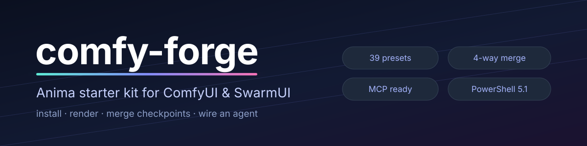

<p align="center">
  
</p>

<p align="center">
  <a href="https://github.com/SenjuWoo/comfy-kit/actions/workflows/ci.yml"></a>
  <a href="https://github.com/SenjuWoo/comfy-kit/releases"></a>
  <a href="LICENSE"></a>
  
</p>

<p align="center">
  Install Anima, render a preset, merge four checkpoints into one, and connect an
  agent — without hand-editing JSON or averaging <code>.safetensors</code> in your head.
</p>

<p align="center">
  
  <br>
  <sub>1024×1024, rendered from a four-way merge made with this kit —
  <code>Anima - Official Best (ER-SDE + SGM)</code>.</sub>
</p>

---

## Quick start

```powershell
# 1. fetch whatever is missing: models, node pack, python modules
powershell -File TOOLS\image-stack.ps1 install

# 2. start SwarmUI (launch-windows.bat), then render
powershell -File TOOLS\image-stack.ps1 generate -Prompt "a neon alley at night, rain, reflections"

# 3. merge four checkpoints into one file
#    all four must share a lineage; if their true ancestor is missing, add
#    -AcceptFallbackAnchor and the first donor becomes the anchor WITHOUT
#    losing its weight (the CLI prints the resulting shares)
powershell -File TOOLS\image-stack.ps1 merge -Base "<same-lineage base>" `
  -Donors "<a>","<b>","<c>","<d>" -Weights 0.85,0.75,0.6,0.5
```

`install` is safe to re-run: it downloads only what is missing and
verifies each file by SHA-256, so re-running is cheap and safe.

## Commands

| Command | What it does |
|---|---|
| `status` | Frontend, models, server, ComfyUI port, and every requirement with a fix line |
| `install` | Models, both node packs (HaDeS + RES4LYF) and the python merge modules — whatever is missing |
| `presets` | List the presets; `-Name "<preset>"` prints one preset's settings |
| `generate` | Render through SwarmUI's API into `out\` |
| `merge` | Write a merged `.safetensors` and refresh SwarmUI's model list |
| `mcp` | Print a ready client config for the ComfyUI MCP server |

## Captioning a LoRA dataset

Point it at a folder of images — with or without existing imgbrd-grabber `.txt` captions — plus a concept, and it writes a new dataset folder with one Anima-ready caption per image. Sources are never modified. Training happens on Civitai; this is the front half.

```
powershell -File TOOLS/Install-Tagger.ps1          # once, ~1.2 GB, Apache-2.0 weights
python TOOLS/anima_dataset.py --images "S:\my\shots" --out "S:\my\shots-dataset" ^
  --trigger mychar --concept "an original anime illustration" --zip mychar.zip
```

Existing grabber captions are converted; only images without one are tagged. `--mode convert` never loads a tagger, `--mode retag` merges into your tags instead of replacing them. `_review.tsv` shows every caption before you train. Full options and limits: [docs/DATASET.md](docs/DATASET.md).

## What's in the box

| | |
|---|---|
| **42 presets** | Anima, FLUX.1/2, Krea 2, SDXL, Z-Image — shot parameters only, no workflow graph |
| **Anima installer** | 2.9B bf16 + Qwen3 0.6B encoder + Qwen Image VAE, pinned by hash |
| **Merge tool** | Task arithmetic over up to four checkpoints, streamed write, provenance in metadata |
| **ComfyUI graph** | `workflows/anima-4way-merge.json` for the node editor (`install` fetches the node pack) |
| **MCP config** | `comfyui-mcp` pinned, compact tool mode, pointed at the port that is actually listening |

## Merging checkpoints

```powershell
powershell -File TOOLS\image-stack.ps1 merge `
  -Donors "Versetility - Diving-Anima_v9.0.safetensors",
          "Details - Terra Rising Unity 3.0 - Turbo.safetensors",
          "Composition - hentai_studio_quality-000008.safetensors",
          "Consistensy - One obsession_animaV5turbo.safetensors" `
  -Weights 0.85,0.75,0.60,0.50 `
  -AcceptFallbackAnchor
```

`-Base` names the shared ancestor. When the true ancestor is not on disk, the
CLI refuses rather than silently changing your recipe; `-AcceptFallbackAnchor`
then uses the first donor as the computational anchor and keeps it in the donor
list with its weight, so the blend still sums to your intended 31.5/27.8/22.2/18.5.

The finished file lands in **both** model trees — SwarmUI's
`Models\Stable-Diffusion\Anima\` and ComfyUI's
`dlbackend\comfy\ComfyUI\models\diffusion_models\` — linked, not copied, so it
costs no extra disk and shows up in the node editor and the MCP too.

The formula matches the ComfyUI node:

```
out = anchor + scale · Σ wᵢ(θᵢ − anchor) / Σ wᵢ
```

**The anchor matters more than the weights.** See below.

### The 40-block trap

Anima ships in two generations that look interchangeable and are not:

| Checkpoint | Blocks | A blend of the two |
|---|---|---|
| `Anima-2.9B-preview-v1` | **40** (layer-expanded) | with 28-block fine-tunes → **renders pure black** |
| the four fine-tunes above | **28** | anchored on one of their own → **renders correctly** |

Pairing block *N* of a 40-block model with block *N* of a 28-block model mixes
unrelated layers. The file loads, the sampler runs, and you get a black PNG with
no error anywhere. `merge_anima.py` counts the blocks and refuses. The CLI can anchor on the first
donor instead, but only when you pass `-AcceptFallbackAnchor`, and that donor
keeps its weight in the denominator rather than being dropped. An explicit
`-Base` is never overridden.

### Samplers and schedulers from RES4LYF

`beta57`, `bong_tangent`, `res_2s`, `res_2m` and `rk_beta` are not in SwarmUI or
ComfyUI out of the box. `install` clones **RES4LYF** into `custom_nodes`, which
registers them with ComfyUI, and SwarmUI merges that list into its own dropdown
when its backend connects — so **restart SwarmUI after installing**. Measured
here: schedulers 9 → 11, samplers 45 → 64.

`anima_beta57` in the HaDeS graph is the same schedule as RES4LYF's **`beta57`**
(`beta_scheduler(alpha=0.5, beta=0.7)`); use `beta57` in SwarmUI.

A merge of a **full checkpoint** (UNET + encoder + VAE) keeps everything the base
carries and blends only the UNET, so the result loads in `CheckpointLoaderSimple`
as well as `UNETLoader`.

Full reference — weights, scale, methods, compatibility rules and how to check a
merge: **[docs/MERGE.md](docs/MERGE.md)**.


## Requirements

| | |
|---|---|
| Windows | PowerShell 5.1 (built in) |
| SwarmUI | [mcmonkeyprojects/SwarmUI](https://github.com/mcmonkeyprojects/SwarmUI) — run `launch-windows.bat` once |
| GPU | ~10 GB free VRAM for 1024×1024; less works, slower |
| Disk | ~7.3 GB for the model stack |
| Node.js 18+ | only for the MCP server |

No build step, no virtualenv to create, no service to host. Merges use the Python
that ships inside ComfyUI, so nothing is installed globally.

## Verified, and not

Tested on Windows 11 with SwarmUI v0.9.8.4 (its bundled ComfyUI), RTX 4080 SUPER,
Python 3.12 embedded. Version: see `VERSION` (single source of truth).

| Check | Result |
|---|---|
| Model install | 5.84 GB downloaded, SHA-256 verified |
| Preset render | real 1024×1024 PNG, 27 s at 28 steps |
| Four-way merge | merged and rendered — the image at the top of this page |
| Self-merge | bit-identical to the base, and renders |
| Merge math | weights, scale, dtype policy, topology, metadata, writer rollback, encoder/VAE protection |
| Lineage gate | 40-block base + 28-block donor refused, never silently blended |
| MCP handshake | `comfyui-mcp@0.52.206`, `list_tools` / `describe_tool` / `call_tool` |

Not verified: hosts other than Windows, and standalone ComfyUI installs (this was
built against SwarmUI, which drives its own ComfyUI backend).

## Troubleshooting

| Symptom | Fix |
|---|---|
| `SwarmUI is not running` | `launch-windows.bat` in the SwarmUI folder first |
| A merged model renders black | The blend paired different layer counts — merge within one lineage |
| `Invalid value for parameter VAE` | Presets carry `Automatic`; the CLI strips it, the UI needs a real VAE |
| New checkpoint missing from the UI | `status`, then restart SwarmUI — its model list is cached at startup |
| `missing hades nodes` | `install` clones the pack into `custom_nodes` |
| Merge says `nothing to merge` | Run with `--dry-run` for the per-tensor breakdown |

## Layout

```
TOOLS/image-stack.ps1            the CLI
TOOLS/merge_anima.py             the merge engine
TOOLS/Ensure-AnimaSwarmUI.ps1    model download and verification
presets/                         42 presets, hash-pinned manifest
workflows/                       ComfyUI 4-way merge graph
docs/                            MERGE.md, banner, sample render
TESTS/                           merge math, installer gate, PS parse, MCP handshake
```

## Licence

MIT for the scripts and docs (`LICENSE`). The Anima weights are third-party and
keep their own licence — this repo only pins their bytes. `comfyui-mcp` and the
HaDeS Anima Suite are separate projects used as dependencies, not vendored here.
